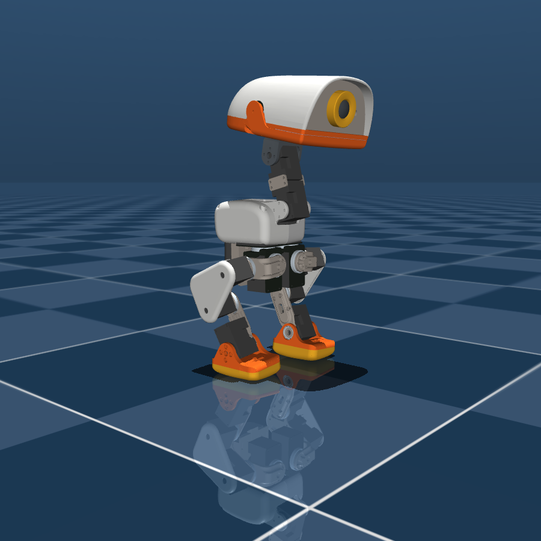
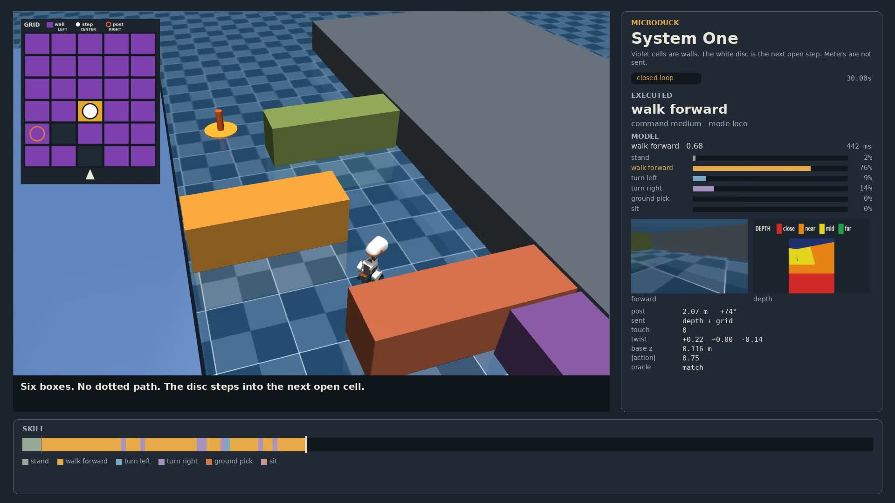

# decision-robot-control

<p align="center">
  
</p>

d1 names the skill. MicroDuck's policies walk, turn, pick, and sit.

<p align="center">
  <a href="docs/maze.mp4"></a>
</p>

Six boxes. The white disc is the next gap. The model reads the picture and names the skill. The policies move the joints.

## Run

```bash
uv sync
cp .env.example .env
```

`DECISION_BASE_URL` is a local [llama.cpp](https://github.com/ggerganov/llama.cpp) server, or any host that accepts `POST /v1/systemone`. Set `DECISION_MODEL` and `DECISION_API_KEY` when the host asks for them. `DECISION_URL` is the old name for the base URL.

```bash
llama-server -m d1-3B-Q8_0.gguf --mmproj mmproj-d1-3B-Q8_0.gguf --port 8091 --host 127.0.0.1 -c 2048
```

CUDA build on NVIDIA. SYCL build on Arc. Same flags.

```bash
git clone --depth 1 https://github.com/pollen-robotics/microduck_rl
```

Set `MICRODUCK_SCENE` to `scene.xml` in that clone. The meshes stay there. The three policies in `policies/` are Pollen's, Apache-2.0.

```bash
MUJOCO_GL=egl uv run python packages/microduck-harness/full_demo.py --vision
```

`--vision` leaves distance and bearing out of the request.

Policies are ONNX. `onnxruntime-gpu` uses CUDA. `onnxruntime-openvino` uses an Intel GPU. ONNX Runtime has no XPU provider. Without one of those wheels the policies stay on CPU.

The scene's position actuators track a medium walk command more slowly than the command says.
